<div align="center">

# ProFarm

**Crop and soil guidance, local weather, mandi prices and a farm diary for Indian farmers, in English, Hindi, Punjabi, Telugu and Tamil.**

[](https://github.com/JayantBansal900/ProFarm-V2/actions/workflows/ci.yml)


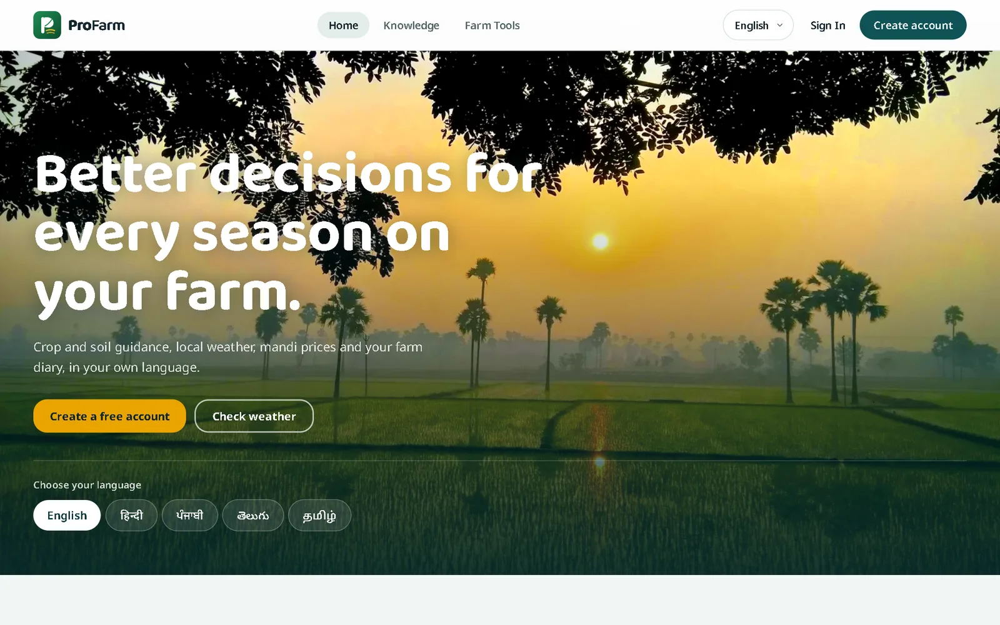

</div>

## What it does

- **Knowledge:** 12 crops and 6 soil types, each with a photo, growing seasons, water and temperature needs, sowing and harvest windows, suitable soils and sustainable practices. A **Listen** button reads a page aloud using the browser's speech engine.
- **Weather:** search any village, town or city and get current conditions, a 7-day forecast, rainfall totals and plain-language advice for field work ([Open-Meteo](https://open-meteo.com)).
- **Mandi prices:** daily wholesale prices from AGMARKNET with state and district filters and market-by-market comparison ([data.gov.in](https://data.gov.in)).
- **Crop advisor:** rule-based guidance for a chosen crop and soil, optionally using the local forecast.
- **Farm planner:** farms, crop cycles (with expected harvest dates), activity history and tasks with overdue tracking, a dashboard of what needs doing next, and a monthly calendar. Archived farms are read-only.
- **Accounts and security:** sign-up and sign-in, optional **two-step verification** with an authenticator app and backup codes.
- **Admin panel:** admins manage accounts, but they can never see what is inside a farmer's farms.
- **Five languages:** English, Hindi, Punjabi, Telugu and Tamil, chosen on the home page or from the header.
- **This season:** the home page suggests the crops that can be sown in the current Indian season (Kharif, Rabi or Zaid).

## Screenshots

<table>
  <tr>
    <td width="50%">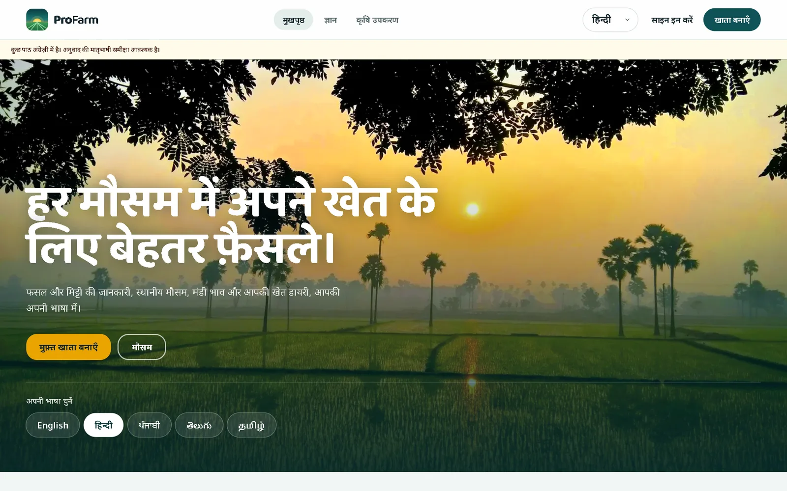<br><sub><b>Hindi</b>: the whole interface switches language</sub></td>
    <td width="50%">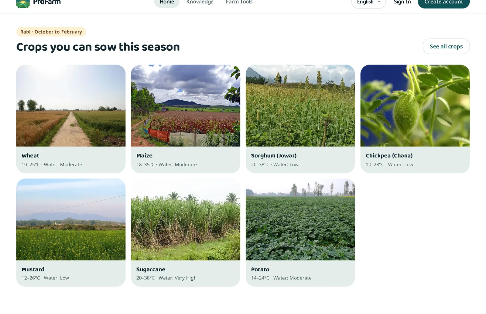<br><sub><b>Crops to sow this season</b></sub></td>
  </tr>
  <tr>
    <td>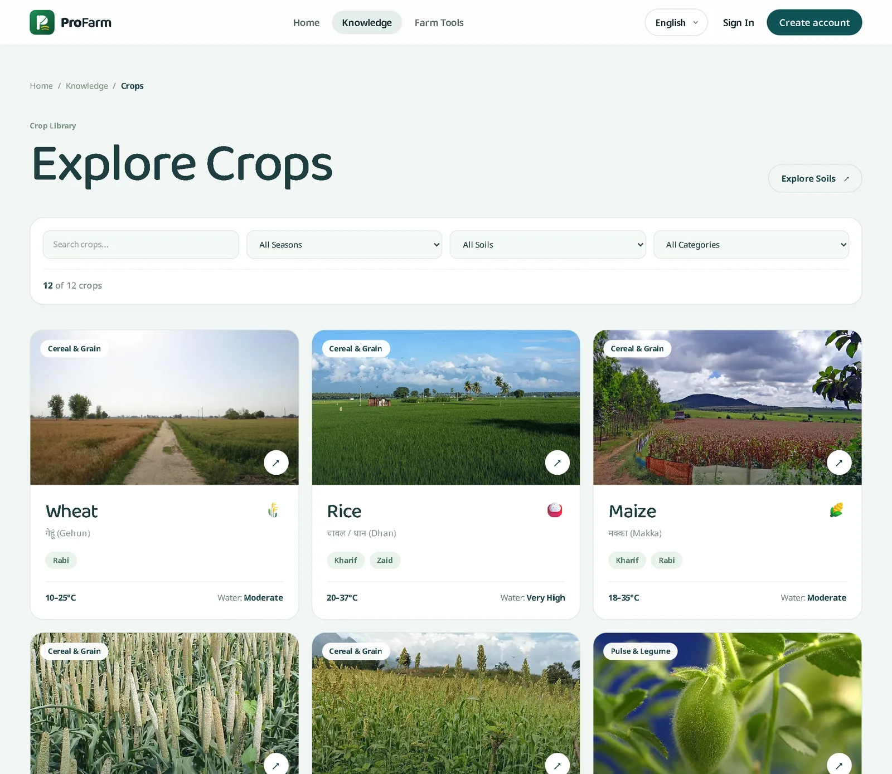<br><sub><b>Crop library</b></sub></td>
    <td>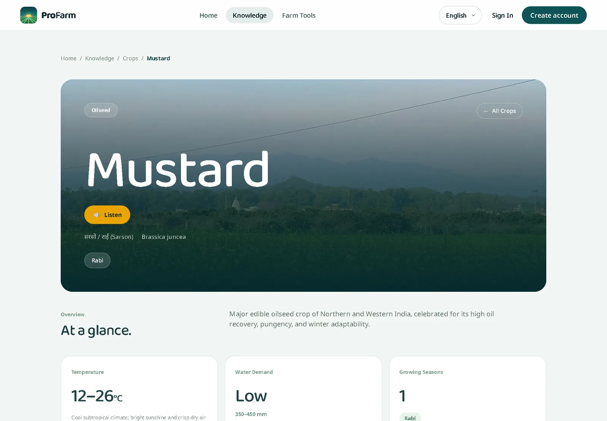<br><sub><b>Crop detail</b> with read-aloud</sub></td>
  </tr>
  <tr>
    <td>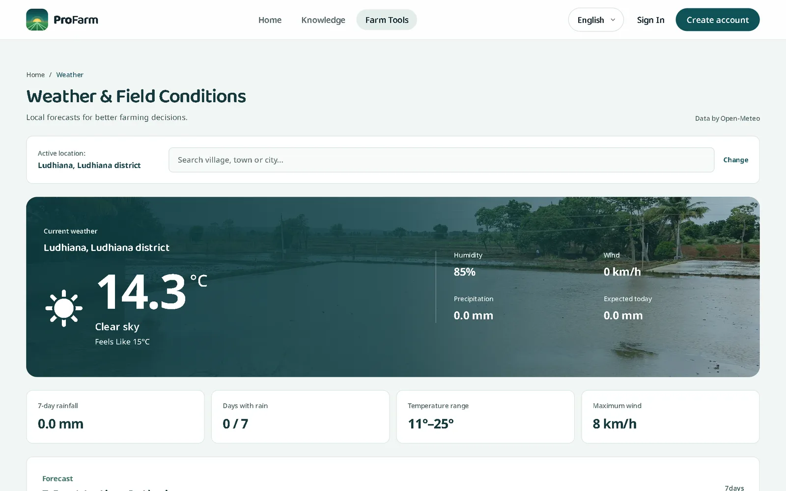<br><sub><b>Weather</b> (live, Open-Meteo)</sub></td>
    <td>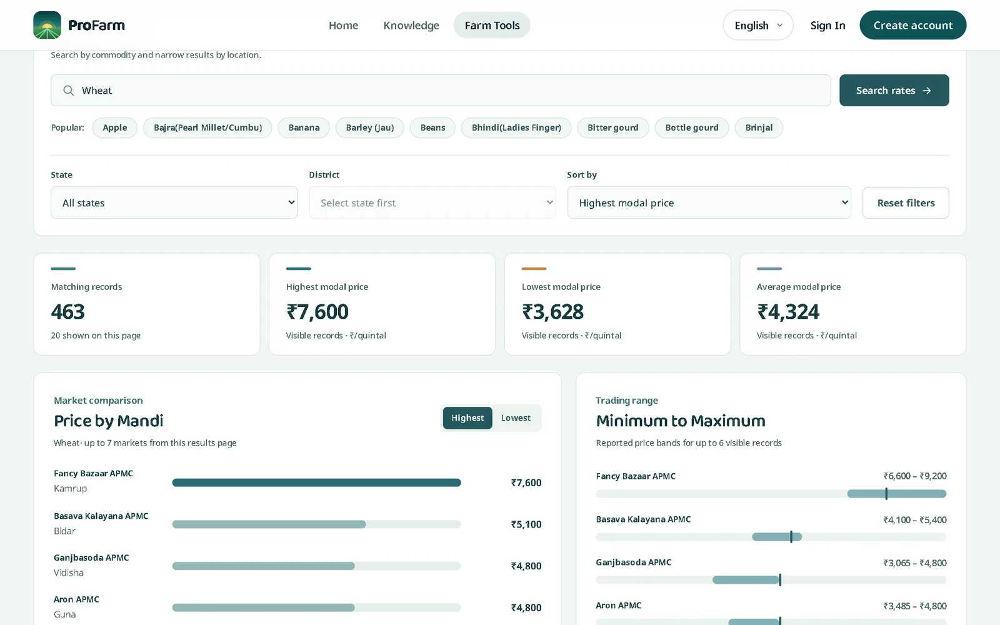<br><sub><b>Mandi prices</b> (live, data.gov.in)</sub></td>
  </tr>
  <tr>
    <td>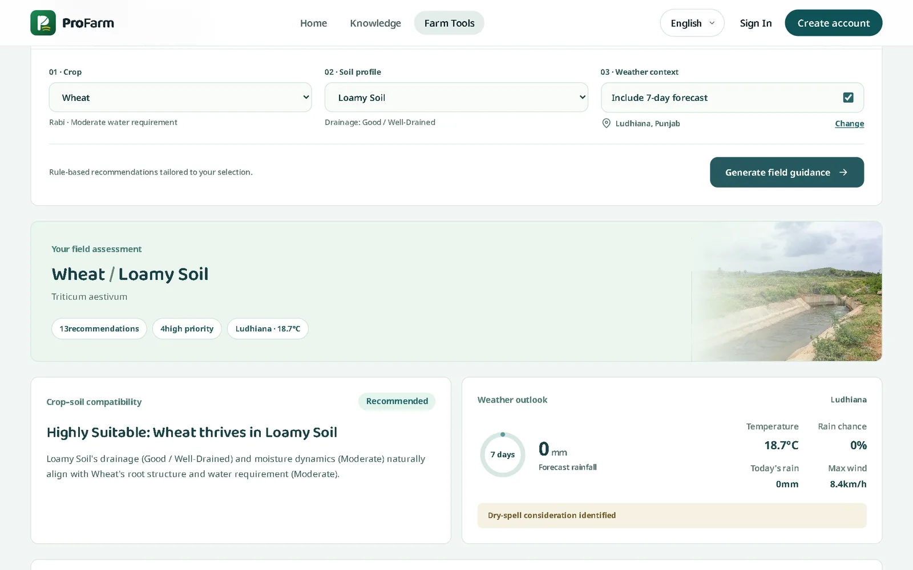<br><sub><b>Crop advisor</b></sub></td>
    <td>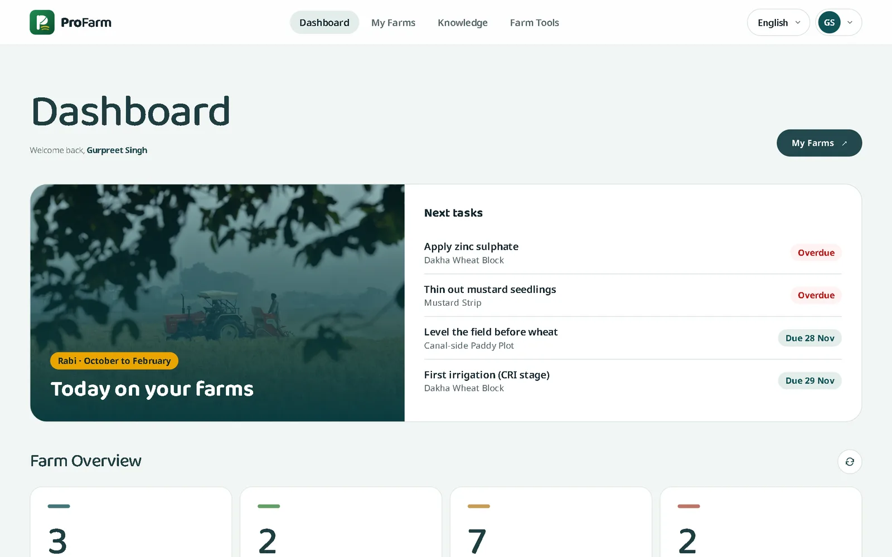<br><sub><b>Dashboard</b> with overdue tasks</sub></td>
  </tr>
  <tr>
    <td>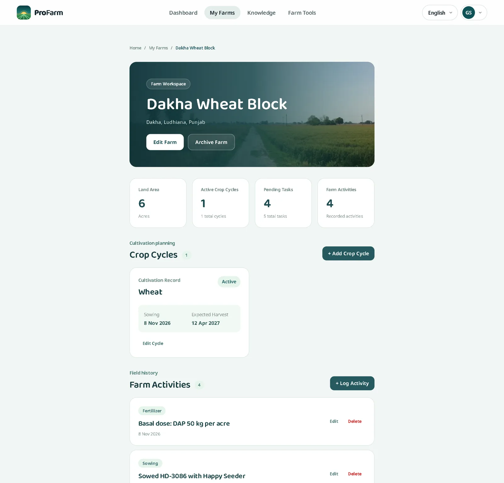<br><sub><b>Farm</b>: crop cycles and expected harvest</sub></td>
    <td>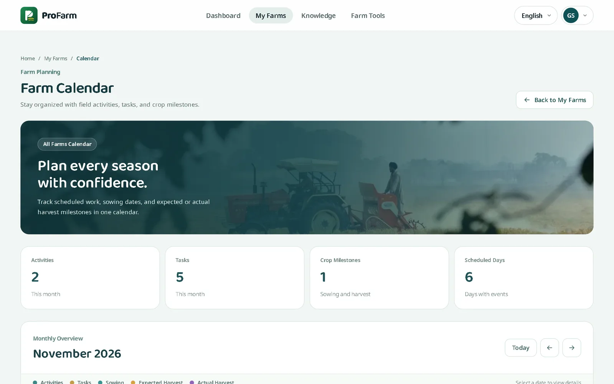<br><sub><b>Calendar</b></sub></td>
  </tr>
  <tr>
    <td>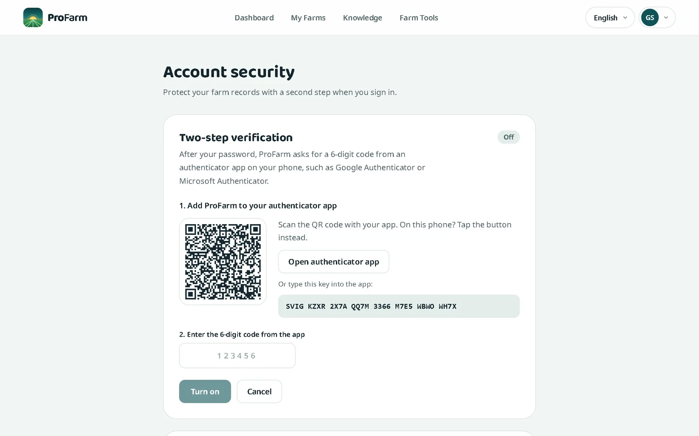<br><sub><b>Two-step verification</b> setup</sub></td>
    <td>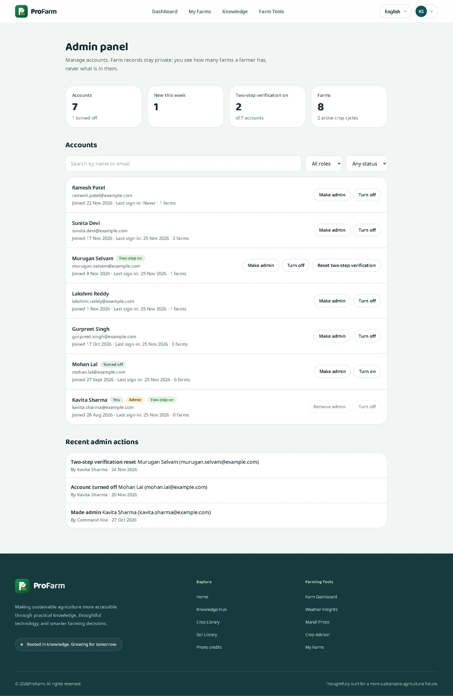<br><sub><b>Admin panel</b> and audit log</sub></td>
  </tr>
</table>

<p align="center">
  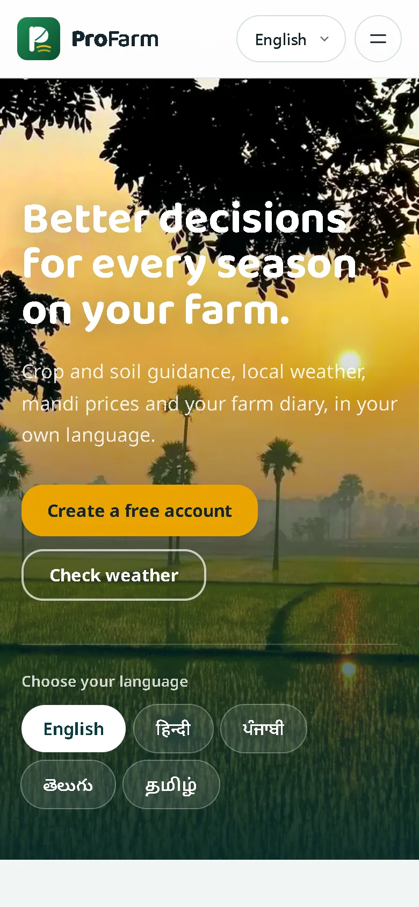
  &nbsp;&nbsp;&nbsp;
  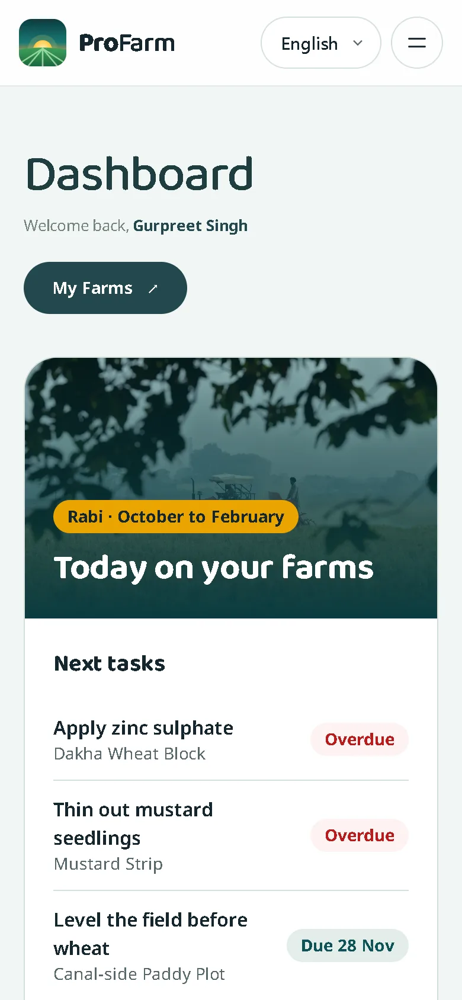
  <br><sub>Works on phones</sub>
</p>

All screenshots use made-up farmers and farms.

## Engineering highlights

- **Authentication:** Argon2id password hashing, random server-side session tokens stored as SHA-256 hashes, `HttpOnly` `SameSite=Lax` cookies, Origin-based CSRF checks, strict single-origin CORS, Helmet, Zod validation of request input, and rate limits on the API and on sign-in.
- **Two-step verification:** TOTP (RFC 6238, tested against the RFC's own vectors) with one step of clock drift allowed. Each code works only once, and sign-in challenges expire after 5 minutes and lock after 5 wrong codes. Secrets are encrypted at rest with AES-256-GCM, and the 10 backup codes are stored hashed.
- **Access control:** every farm query is scoped to the signed-in owner. Admin routes re-read the role from the database on every request, require two-step verification, and write to an audit log. Turning an account off ends its sessions immediately, and admins cannot turn off or demote themselves.
- **Correct dates:** "today" for due dates and overdue tasks follows the Indian calendar day (`APP_TIMEZONE`, default `Asia/Kolkata`) regardless of where the server runs.
- **Localization:** a build-time check fails if any interface string is missing in any of the five languages.
- **Testing:** 615 automated tests (449 backend, 166 frontend). Backend tests run against a disposable SQLite database created for each run, behind a guard that refuses to run against the development database. GitHub Actions runs typecheck, lint, tests and the build on every pull request.

## Tech stack

| | |
| :--- | :--- |
| **Frontend** | React 18, TypeScript, Vite, Tailwind CSS 3, React Router 7, i18next |
| **Backend** | Node.js, Express 4, TypeScript, Zod 4, Argon2 |
| **Database** | SQLite with Prisma 5 (5 migrations) |
| **Testing** | Vitest, Supertest, React Testing Library, ESLint |
| **Data** | Open-Meteo (weather), data.gov.in AGMARKNET (mandi prices) |

## Getting started

**You need** Node.js 20.19+ (or 22.12+, or 24+) and npm.

```bash
# 1. Install everything (this is an npm workspace: backend + frontend)
npm install

# 2. Create the environment files
cp backend/.env.example backend/.env
cp frontend/.env.example frontend/.env

# 3. Create the local database
cd backend
npx prisma migrate dev
cd ..
```

Run the two servers in two terminals:

```bash
npm run dev:backend    # API on http://localhost:4000
npm run dev:frontend   # App on http://localhost:5173
```

Open **http://localhost:5173** and create an account on the sign-up page.

**Mandi prices** need a free API key from [data.gov.in](https://data.gov.in). Put it in `backend/.env` as `DATA_GOV_IN_API_KEY`. Without it the rest of the app works, and the mandi endpoints answer "temporarily unavailable".

### Making someone an admin

Sign-up never creates an admin. After the person has signed up:

```bash
npm --workspace=backend run admin:grant  -- farmer@example.com
npm --workspace=backend run admin:revoke -- farmer@example.com
```

They then turn on two-step verification from **Account security**, which the admin panel requires.

## Scripts

Run from the repository root.

| Command | What it does |
| :--- | :--- |
| `npm run dev:backend` / `npm run dev:frontend` | Start a development server with hot reload |
| `npm run typecheck` | TypeScript checks for backend and frontend |
| `npm run lint` | ESLint for backend and frontend |
| `npm test` | All tests (backend, then frontend) |
| `npm run build` | Production builds |
| `npm --workspace=frontend run check:locales` | Verify every string is translated in all five languages |

## Environment variables

| Variable | Where | Purpose |
| :--- | :--- | :--- |
| `DATABASE_URL` | backend | SQLite file, `file:./dev.db` by default |
| `PORT` | backend | API port, `4000` by default |
| `FRONTEND_ORIGIN` | backend | The one origin allowed by CORS and CSRF checks |
| `DATA_GOV_IN_API_KEY` | backend | Key for mandi prices |
| `MFA_ENCRYPTION_KEY` | backend | Encrypts authenticator secrets. **Required in production** (32+ random characters), optional in development |
| `APP_TIMEZONE` | backend | Timezone that decides what "today" is, `Asia/Kolkata` by default |
| `VITE_API_BASE_URL` | frontend | API address, `http://localhost:4000` by default |

`OPENWEATHER_API_KEY` and `NASA_POWER_BASE_URL` appear in `.env.example` as placeholders for planned work. Nothing reads them yet.

## API overview

All routes are under `/api`. Health, weather, mandi, advisor and the sign-up, sign-in and sign-out routes are public. Everything else needs a signed-in session.

| Area | Routes |
| :--- | :--- |
| Health | `GET /health`, `GET /health/database` |
| Auth | `POST /auth/register`, `/auth/login`, `/auth/login/mfa`, `/auth/logout`; `GET /auth/me` |
| Two-step | `GET /auth/mfa`; `POST /auth/mfa/setup`, `/enable`, `/disable`, `/backup-codes` |
| Weather | `GET /weather/locations`, `/weather/forecast` |
| Mandi | `GET /mandi/prices`, `/mandi/filters`, `/mandi/trends` |
| Advisor | `POST /advisor/recommendations`; `GET /advisor/crops`, `/advisor/soils` |
| Farms | `/farms` (list, create, overview, calendar), `/farms/:id` and its `/cycles`, `/activities` and `/tasks`, plus archive and restore |
| Admin | `GET /admin/stats`, `/admin/users`, `/admin/audit`; `PATCH /admin/users/:id/role`; `POST /admin/users/:id/deactivate`, `/reactivate`, `/reset-mfa` |

## Project structure

```text
ProFarm-V2/
├── backend/
│   ├── prisma/         # schema and migrations
│   ├── src/
│   │   ├── config/     # environment validation
│   │   ├── controllers/  routes/  services/  validators/
│   │   ├── middleware/ # auth, admin, CSRF, CORS, rate limits, errors
│   │   ├── lib/        # TOTP, secret encryption, timezone, cache
│   │   ├── data/       # crop, soil and practice knowledge
│   │   └── scripts/    # admin:grant / admin:revoke
│   ├── tests/          # API and unit tests
│   └── testing/        # disposable-database safety guard
├── frontend/
│   ├── public/images/  # crop, soil and scene photos (WebP)
│   └── src/
│       ├── api/  components/  context/  pages/  data/  utils/
│       └── i18n/       # five languages and the build-time check
├── .github/workflows/  # CI
└── package.json        # npm workspace root
```

## Data sources and credits

- Weather: [Open-Meteo](https://open-meteo.com). Mandi prices: Agmarknet via [data.gov.in](https://data.gov.in).
- Crop, soil and landscape photos come from [Wikimedia Commons](https://commons.wikimedia.org) under Creative Commons licences. Every author and licence is listed on the in-app `/credits` page.

## Known limitations

- **Translations are drafts.** They have not been reviewed by native speakers, and the long crop and soil descriptions are still in English (the app shows a notice in the other languages).
- **Mandi history is not available.** The source publishes one day at a time, so the trends endpoint says so instead of inventing data.
- **Not built yet:** NASA POWER data, crop yield prediction, password change and reset, deleting farms or tasks (farms can be archived), reminders and notifications.
- **Not deployed.** There is no Docker or hosting configuration yet. SQLite suits a single server; a larger deployment would move to PostgreSQL.

## License

ISC / Proprietary — ProFarm Project.
