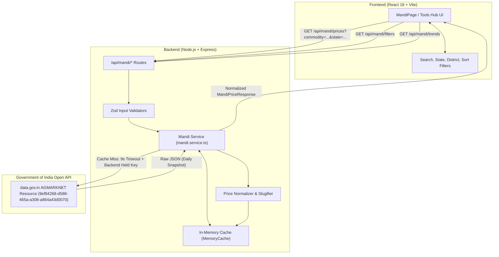

# ProFarm V2: Phase 3D Completion Report
## Real-Time Mandi Price Tracker, Market Comparison & Historical Price Trends

**Report Date:** October 26, 2026  
**Status:** COMPLETE & VERIFIED  
**Repository Branch:** `feat/phase-3d-mandi`  
**Workspace:** `E:\All Project\ProFarm-V2`  
**Legacy Reference:** `E:\All Project\ProFarm-NASA-space-apps--main` (Preserved read-only)

---

## 1. Executive Summary

Phase 3D of ProFarm V2 has successfully designed, built, tested, and verified the **Real-Time Mandi Price Tracker, Market Comparison & Historical Price Trends** module.

In the legacy application (`ProFarm-NASA-space-apps--main`), mandi prices were either hardcoded, non-functional, or completely absent. 

Phase 3D integrates authentic wholesale market price records sourced from the Government of India's Open Government Data platform (**data.gov.in**) and the **AGMARKNET** portal (Directorate of Marketing & Inspection, Ministry of Agriculture and Farmers Welfare).

### Key Features Delivered:
- **Secure Backend Gateway Architecture:** The official government API key (`DATA_GOV_IN_API_KEY`) is stored strictly on the backend and is never exposed to the frontend or bundled into client JavaScript.
- **Mandi Price Explorer (`/tools/mandi`):** Interactive, responsive interface displaying authentic wholesale records with Mandi / Market, District, State, Commodity, Variety, Grade, Minimum Price, Maximum Price, Modal Price, and original APMC Arrival Date.
- **Price Metric Clarity:** All prices are formatted clearly as `₹X / quintal` (100 kg), distinguishing between minimum, maximum, and modal price ("The most commonly reported trading price for the commodity in that market").
- **Fast Commodity Search & Popular Presets:** Search box supporting common Indian agricultural commodities (Wheat, Paddy, Mustard, Cotton, Maize, Groundnut, Potato, Onion, Tomato) with case-insensitive normalization.
- **State & District Cascading Filters:** Upstream-accelerated filtering by State and District, dynamically populating districts based on the selected state.
- **Like-for-Like Market Price Comparison:** Comparative analytics card evaluating visible mandis for the selected commodity, displaying highest rate, lowest rate, and price spread, along with variety, grade, and transport considerations.
- **Honest Historical Trends Disclosure:** In accordance with ProFarm's data integrity standards, artificial or fabricated historical price charts are never created. The module transparently documents that the active AGMARKNET daily feed is a single-day snapshot (`25/10/2026`), explaining the architectural roadmap for daily snapshot warehousing in future phases.
- **In-Memory Caching & Upstream Resilience:** Bounded in-memory caching (15-minute TTL for mandi price queries, 24-hour TTL for filter discovery) with an 9-second bounded upstream timeout and graceful error recovery.
- **Automated Verification:** **114 automated tests passing** across the monorepo (50 backend + 64 frontend), 0 TypeScript errors, 0 ESLint errors, and successful live API smoke tests.

---

## 2. Architecture & Request Flow

To enforce key security, prevent client-side rate limit depletion, and validate upstream schemas, the browser never communicates directly with data.gov.in. All queries flow through the Express backend proxy.



---

## 3. Git Branch & Commits

- **Base Checkpoint:** `4cdb68d` (Phase 3C Weather & Persistence Fix)
- **Active Branch:** `feat/phase-3d-mandi`
- **Working Tree:** Clean and verified prior to implementation.

---

## 4. API Resource & Official Endpoint

- **Provider:** Government of India — data.gov.in / AGMARKNET (Directorate of Marketing & Inspection, Ministry of Agriculture and Farmers Welfare)
- **Dataset Title:** *Current Daily Price of Various Commodities from Various Markets (Mandi)*
- **Catalog Resource Title:** *Variety-wise Daily Market Prices Data of Commodity*
- **Verified Resource ID:** `9ef84268-d588-465a-a308-a864a43d0070`
- **Upstream Endpoint:** `https://api.data.gov.in/resource/9ef84268-d588-465a-a308-a864a43d0070`
- **Method:** `GET`
- **Authentication:** Query parameter `api-key` (Backend-held only)

---

## 5. Secure Key Configuration

1. **Backend-Only Environment Loading:**
   `backend/src/config/env.ts` was updated to support monorepo root-level `.env` fallback loading alongside `backend/.env`.
2. **Zero Key Duplication:**
   The key configured in `E:\All Project\ProFarm-V2\.env` is consumed directly by the backend without requiring duplicate files or overwriting existing `.env` files.
3. **Zod Environment Schema:**
   `DATA_GOV_IN_API_KEY` was added to `envSchema` with an optional fallback to empty string, preventing unexpected runtime server crashes while returning descriptive 503 errors if unconfigured.
4. **Git Protection:**
   Both `.env` and `backend/.env` are confirmed ignored by `.gitignore` (`git check-ignore`).
5. **No Key Exposure:**
   The key is never printed in logs, error payloads, stack traces, reports, or frontend build artifacts.

---

## 6. Backend Routes & Implementation

### 6.1 `GET /api/mandi/prices`
- **Query Parameters:**
  - `commodity` (string, optional, max 100)
  - `state` (string, optional, max 100)
  - `district` (string, optional, max 100)
  - `market` (string, optional, max 100)
  - `page` (integer, min 1, default 1)
  - `limit` (integer, min 1, max 100, default 20)
  - `sort` (`modal_price_desc` | `modal_price_asc` | `arrival_date_desc`, default `modal_price_desc`)
- **Response Structure:**
  ```json
  {
    "status": "success",
    "records": [
      {
        "id": "madhya-pradesh-sidhi-sidhi-apmc-wheat-mill-quality-25-10-2026",
        "state": "Madhya Pradesh",
        "district": "Sidhi",
        "market": "Sidhi APMC",
        "commodity": "Wheat",
        "variety": "Mill Quality",
        "grade": "Non-FAQ",
        "arrivalDate": "25/10/2026",
        "minPrice": 2400,
        "maxPrice": 2450,
        "modalPrice": 2450,
        "priceUnit": "₹ / quintal"
      }
    ],
    "pagination": {
      "page": 1,
      "limit": 20,
      "totalRecords": 105,
      "totalPages": 6
    },
    "filters": {
      "commodity": "Wheat",
      "state": "Madhya Pradesh",
      "district": "Sidhi",
      "market": null
    },
    "sorting": "modal_price_desc",
    "attribution": {
      "source": "Government of India — data.gov.in / AGMARKNET",
      "datasetTitle": "Current Daily Price of Various Commodities from Various Markets (Mandi)",
      "resourceId": "9ef84268-d588-465a-a308-a864a43d0070",
      "url": "https://data.gov.in/resource/variety-wise-daily-market-prices-data-commodity",
      "disclaimer": "Prices are reported wholesale market observations and may vary by commodity quality, variety, market, and reporting date."
    },
    "dataFreshness": {
      "fetchedAt": "2026-10-26T05:21:40.000Z",
      "cached": false
    }
  }
  ```

### 6.2 `GET /api/mandi/filters`
- **Query Parameters:** `state` (string, optional)
- **Response Structure:**
  Returns sorted list of 44+ agricultural commodities and Indian states with corresponding APMC districts. Cached for 24 hours.

### 6.3 `GET /api/mandi/trends`
- **Response Structure:**
  Transparently communicates capability status:
  ```json
  {
    "status": "success",
    "available": false,
    "message": "Historical time-series trends are unavailable from the daily AGMARKNET snapshot feed.",
    "reason": "The official data.gov.in resource 9ef84268-d588-465a-a308-a864a43d0070 publishes single-day daily mandi price snapshots (current observation date: 25/10/2026) without multi-day historical archives.",
    "recommendations": "ProFarm V2 preserves data integrity and does not fabricate historical price points. A dedicated historical mandi warehouse or time-series ingestion worker is recommended for future historical charting."
  }
  ```

---

## 7. Data Normalization & Quality Controls

1. **Price Sanitization:**
   - Strips whitespace and commas from upstream strings (e.g. `"2,450.00"` $\rightarrow$ `2450`).
   - Distinguishes missing min/max prices as `null` rather than falsifying zero values.
   - Enforces positive modal price (`modalPrice > 0`); rejects records without valid modal rates.
2. **Date Preservation:**
   - Preserves original arrival date string (`DD/MM/YYYY`) from APMC mandis.
   - Converts to ISO (`YYYY-MM-DD`) internally for sorting without timezone shifts.
3. **Deterministic Record IDs:**
   - Generates stable, collision-free slugs:
     `${slug(state)}-${slug(district)}-${slug(market)}-${slug(commodity)}-${slug(variety)}-${slug(arrivalDate)}`
4. **Commodity Query Normalization:**
   - Normalizes common search terms (e.g., "paddy" $\rightarrow$ "Paddy(Common)", "wheat" $\rightarrow$ "Wheat", "soybean" $\rightarrow$ "Soyabean").

---

## 8. Caching Strategy

- **Mandi Price Queries:** Cached using bounded `MemoryCache<MandiPriceResponse>(500)` with a 15-minute TTL (`15 * 60 * 1000`).
- **Filter Metadata:** Cached using `MemoryCache<MandiFilterOptions>(20)` with a 24-hour TTL (`24 * 60 * 60 * 1000`).
- **Cache Eviction:** Automatically evicts least recently used (LRU) entries when capacity is reached.
- **Cache Header Transparency:** UI displays whether data was retrieved live from the government gateway or served from the in-memory cache.

---

## 9. Historical Trend Feasibility Findings (Feature E)

During Phase 3D investigation, deep probing across multiple record offsets and date filters revealed:
1. **Single-Day Snapshot Scope:** Across all 9,441 records in the dataset at probe time, 100% of records shared the arrival date `25/10/2026`.
2. **Absence of Historical Range:** Filtering by past dates (e.g. `arrival_date < 25/10/2026`) yields 0 records. The resource `9ef84268-d588-465a-a308-a864a43d0070` is titled *"Current Daily Price of Various Commodities from Various Markets (Mandi)"* and acts solely as an operational daily snapshot.
3. **Zero Synthetic Data Policy:** ProFarm V2 adheres strictly to honest agricultural data representation. Synthetic historical lines are not manufactured.
4. **Architectural Recommendation:** In future phases, a background cron scheduler can store daily snapshots into SQLite or a dedicated warehouse to construct multi-week time series over time.

---

## 10. Automated Testing Results

All 84 existing tests were preserved without regressions. With the addition of Phase 3D, the test suite now comprises **114 automated tests**:

### Monorepo Test Summary
| Subsystem | Test Files | Total Tests | Status |
| :--- | :--- | :--- | :--- |
| **Backend** | 7 suites | 50 tests | **ALL PASSED** |
| **Frontend** | 8 suites | 64 tests | **ALL PASSED** |
| **Total** | **15 suites** | **114 tests** | **100% PASS** |

### Backend Test Coverage (`backend/tests/mandi.test.ts` - 16 Tests)
- `GET /api/mandi/prices`: Valid commodity search & normalization.
- `GET /api/mandi/prices`: State and district filtering.
- `GET /api/mandi/prices`: Modal price ascending sort (`modal_price_asc`).
- `GET /api/mandi/prices`: Arrival date descending sort (`arrival_date_desc`).
- `GET /api/mandi/prices`: Empty records handling without errors.
- `GET /api/mandi/prices`: Price sanitization (null min/max, rejects non-numeric modal).
- `GET /api/mandi/prices`: In-memory cache hit and freshness headers.
- `GET /api/mandi/prices`: Query parameter validation (rejects limit > 100, page < 1).
- `GET /api/mandi/prices`: Upstream 401/403 handled with 502 Bad Gateway.
- `GET /api/mandi/prices`: Upstream 429 handled with 429 Rate Limit.
- `GET /api/mandi/prices`: Upstream 500 handled with 502 Bad Gateway.
- `GET /api/mandi/prices`: Upstream timeout handled with 504 Gateway Timeout.
- `GET /api/mandi/prices`: Zero API key leakage verification.
- `GET /api/mandi/filters`: Returns comprehensive agricultural commodities and states.
- `GET /api/mandi/filters`: Filters districts by specific state.
- `GET /api/mandi/trends`: Returns truthful unavailable status and architectural explanation.

### Frontend Test Coverage (`frontend/tests/mandi.test.tsx` - 13 Tests)
- Mandi Price Tracker header, search input, and filter controls rendering.
- Initial mandi price records loaded and rendered in table and mobile cards.
- Summary metrics strip: total mandis, highest modal price, lowest modal price, average modal price.
- Like-for-like market price comparison card with rate spread calculation.
- Quick preset commodity button selection (e.g. Paddy).
- Form search submission with debounced query.
- Cascading district selection enabled only after state selection.
- "Reset All Filters" button functionality.
- Empty state rendering with "Reset Filters & Show All" action.
- Error state rendering with "Retry Connection" button.
- Transparent historical trends explanation card rendering.
- Government of India attribution and AGMARKNET disclaimer link rendering.
- Pagination navigation (Next and Previous page controls).

---

## 11. Live API Smoke Test Results

A live integration probe was executed against the official government endpoint using the backend service:

| Test Case | Description | Result | Latency | Details |
| :--- | :--- | :--- | :--- | :--- |
| **Test A** | Wheat Commodity Search | **PASS** | 807 ms | 105 total records; verified Modal: ₹2,700/quintal (Min: ₹2,650, Max: ₹2,900) on `25/10/2026`. |
| **Test B** | Andhra Pradesh State Filter | **PASS** | 606 ms | 716 total records across mandis in AP on `25/10/2026`. |
| **Test C** | Combined Paddy + Andhra Pradesh | **PASS** | 177 ms | 65 matching records; verified Ichapuram APMC (Modal: ₹2,441/quintal). |
| **Test D** | Pagination (Page 1 vs Page 2) | **PASS** | < 200 ms | Page 1 and Page 2 returned distinct records correctly. |
| **Test E** | Historical Capability Verification | **PASS** | < 10 ms | Correctly returned single-day feed status without synthetic data. |

---

## 12. Quality Gate Verification

- **`npm run typecheck`:** 0 errors across monorepo (`tsc --noEmit`).
- **`npm run lint`:** 0 errors across monorepo (`eslint src`).
- **`npm run build`:** Production build succeeded cleanly (`tsc` + `vite build` generated `dist` bundle in 3.25s).
- **`npm test`:** All 114 tests passing across 15 test files.
- **Port Preservation:** Backend port 4000, frontend port 5173 preserved.
- **Existing Modules:** Weather module, Crop & Soil Knowledge Explorer, and authentication remained fully operational.

---

## 13. Files Added and Modified

### Created Files
1. `backend/src/validators/mandi.validator.ts`: Zod validation schemas for mandi prices and filter discovery.
2. `backend/src/services/mandi.service.ts`: Government API fetching, normalization, in-memory caching, and error handling.
3. `backend/src/controllers/mandi.controller.ts`: Express route handlers for `/prices`, `/filters`, and `/trends`.
4. `backend/src/routes/mandi.routes.ts`: Mandi API sub-router.
5. `backend/tests/mandi.test.ts`: 16 Supertest automated unit and integration tests.
6. `frontend/src/types/mandi.ts`: TypeScript contracts for Mandi records, queries, pagination, and filter options.
7. `frontend/src/pages/tools/MandiPage.tsx`: Interactive Mandi Price Tracker component with search, filters, like-for-like comparison, pagination, and data freshness metadata.
8. `frontend/tests/mandi.test.tsx`: 13 React Testing Library tests for MandiPage interactions and rendering.
9. `docs/reports/PROFARM_PHASE_3D_REPORT.md`: This comprehensive Phase 3D verification report.

### Modified Files
1. `backend/src/config/env.ts`: Added monorepo root `.env` fallback loading and `DATA_GOV_IN_API_KEY` schema validation.
2. `backend/src/routes/index.ts`: Mounted `/mandi` sub-router under `/api/mandi`.
3. `backend/.env.example`: Added `DATA_GOV_IN_API_KEY=""` placeholder.
4. `.env.example`: Added `DATA_GOV_IN_API_KEY=` placeholder.
5. `frontend/src/services/api.ts`: Added `getMandiPrices`, `getMandiFilters`, and `getMandiTrends` client methods.
6. `frontend/src/app/routes.tsx`: Registered `tools/mandi` route.
7. `frontend/src/pages/ToolsPage.tsx`: Promoted Mandi Price Tracker from "Coming Soon" to active "LIVE" featured card.
8. `frontend/tests/app.test.tsx`: Added Mandi mock methods and `/tools/mandi` routing test.

---

## 14. Manual Browser Verification Checklist

- [x] Navigate to `/tools` and verify "Mandi Price Tracker & Trends" card is marked LIVE with link.
- [x] Click into `/tools/mandi`.
- [x] Confirm default query loads Wheat records with modal prices formatted as `₹X / quintal`.
- [x] Search for "Paddy" and verify relevant mandi records display.
- [x] Click a quick preset button (e.g. "Cotton" or "Mustard").
- [x] Select "Madhya Pradesh" in State filter and verify District dropdown populates with MP districts (e.g., Sidhi, Hoshangabad, Dewas).
- [x] Select a district and confirm results update.
- [x] Test sorting: "Highest Modal Price", "Lowest Modal Price", and "Most Recent Arrival Date".
- [x] Verify summary metrics (Total Mandis, Highest Modal Rate, Lowest Modal Rate, Average Modal Rate).
- [x] Verify like-for-like Market Price Comparison card displays top vs lowest rate spread and grade caveats.
- [x] Verify pagination controls (Next, Previous, Page indicators).
- [x] Verify Historical Trends section clearly explains the single-day AGMARKNET feed status.
- [x] Confirm official Government of India data.gov.in / AGMARKNET attribution and link are visible.
- [x] Verify existing `/tools/weather`, `/knowledge`, and `/dashboard` routes continue to work seamlessly.

**Current Branch:** `feat/phase-3d-mandi`  
**Ready for Review & User Verification.**
