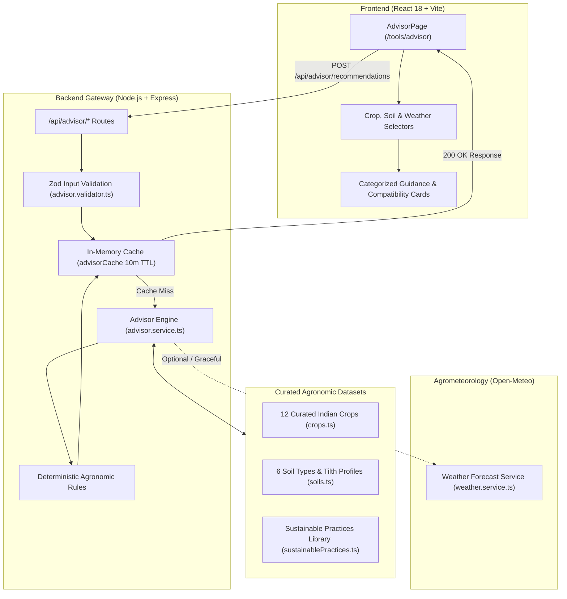

# ProFarm V2: Phase 3E Completion Report
## Sustainable Farming Advisor — Crop, Soil, Weather & Resource-Saving Guidance

**Report Date:** October 26, 2026  
**Status:** COMPLETE & VERIFIED  
**Repository Branch:** `feat/phase-3e-advisor`  
**Workspace:** `E:\All Project\ProFarm-V2`  
**Legacy Reference:** `E:\All Project\ProFarm-NASA-space-apps--main` (Preserved read-only)

---

## 1. Executive Summary

Phase 3E of ProFarm V2 has successfully designed, built, tested, and verified the **Sustainable Farming Advisor**, a trustworthy, practical, rule-based agronomic advisory system synthesizing crop knowledge, soil characteristics, and live agrometeorological forecasts.

Unlike generic AI wrappers or unverified agricultural chatbots, ProFarm Advisor operates on a **deterministic agronomic rules engine** grounded in published research from the **Indian Council of Agricultural Research (ICAR)**, **State Agricultural Universities (e.g., PAU Ludhiana, CRIDA Hyderabad)**, and the **Food and Agriculture Organization (FAO)**.

### Core Principles Delivered:
1. **Explainability & Grounded Evidence:** Every recommendation specifies *Why this applies*, lists exact input evidence points (e.g. crop tier, soil texture, rainfall sum), highlights field limitations, and attributes official agronomic citations.
2. **Deterministic Rules Engine:** No hallucinated facts, no LLM unpredictability, and strictly no fabricated synthetic chemical prescriptions or precise kilogram/liter dosages that require certified on-site agronomic diagnosis.
3. **Graceful Weather Degradation:** When weather is not requested or upstream networks time out, the engine seamlessly produces full crop-care, soil-health, and sustainable practice guidance with `weatherSummary: null`.
4. **Crop-Soil Compatibility Evaluation:** Deterministic matrix cross-referencing root penetration, water tiers, and soil drainage properties to provide `recommended`, `acceptable`, or `challenging` compatibility assessments.
5. **Curated Sustainable Practices Library:** Authoritative catalog covering organic mulching, green manuring (Dhaincha/Sunnhemp), legume-cereal rotation, FYM/vermicomposting, drip irrigation, Broad Bed and Furrow (BBF) drainage, Integrated Pest Management (IPM), and neem-coated urea efficiency.
6. **Live Tools Hub Integration:** Accessible via route `/tools/advisor` with active representation in Tools Hub (`/tools`) alongside Live Weather and Mandi Tracker (total: 3 Live Tools).
7. **Automated Verification:** **139 automated tests passing** across the monorepo (64 backend + 75 frontend), 0 TypeScript compilation errors, 0 ESLint errors, and clean production build.

---

## 2. Architecture & System Flow



---

## 3. API Contracts & Endpoints

### 3.1 `POST /api/advisor/recommendations`
Generates comprehensive categorized guidance based on crop, soil, and optional weather location.

#### Request Body
```json
{
  "cropId": "crop-wheat",
  "soilId": "soil-loam",
  "location": {
    "latitude": 28.61,
    "longitude": 77.23,
    "locationName": "New Delhi"
  }
}
```

#### Response Structure (`200 OK`)
```json
{
  "status": "success",
  "data": {
    "crop": {
      "id": "crop-wheat",
      "slug": "wheat",
      "name": "Wheat",
      "hindiName": "गेहूं (Gehun)",
      "scientificName": "Triticum aestivum",
      "category": "Cereal & Grain",
      "seasons": ["Rabi"],
      "waterRequirement": {
        "level": "Moderate",
        "annualMm": "450–650 mm"
      },
      "temperatureRange": {
        "minC": 10,
        "maxC": 25
      },
      "icon": "🌾",
      "colorTheme": "amber"
    },
    "soil": {
      "id": "soil-loam",
      "slug": "loamy-soil",
      "name": "Loamy Soil",
      "textureCharacteristics": "Medium texture with roughly 40% sand, 40% silt, 20% clay...",
      "drainage": "Good / Well-Drained",
      "waterRetention": "Moderate",
      "nutrientRetention": "High cation exchange capacity...",
      "icon": "🌾",
      "colorTheme": "amber"
    },
    "compatibility": {
      "isCompatible": true,
      "status": "recommended",
      "headline": "Highly Suitable: Wheat thrives in Loamy Soil",
      "reason": "Loamy Soil's drainage (Good / Well-Drained) and moisture dynamics (Moderate) naturally align with Wheat's root structure and water requirement (Moderate)."
    },
    "weatherSummary": {
      "locationName": "New Delhi",
      "temperatureC": 32.0,
      "apparentTemperatureC": 34.5,
      "condition": "Mainly clear",
      "icon": "🌤️",
      "sevenDayTotalRainMm": 34.5,
      "todayRainMm": 0.0,
      "maxDailyPrecipProb": 85,
      "maxWindSpeedKmH": 32.0,
      "heavyRainAlert": true,
      "drySpellAlert": false,
      "heatStressAlert": true,
      "fetchedAt": "2026-10-26T12:00:00.000Z"
    },
    "recommendations": {
      "cropCare": [
        {
          "id": "crop-care-stages-crop-wheat",
          "category": "crop_care",
          "priority": "high",
          "title": "Key Growth Stages & Care for Wheat",
          "explanation": "Crucial irrigation stages include CRI (20–25 DAS), tillering (40–45 DAS), jointing, flowering, and grain filling...",
          "whyThisApplies": "Selected crop is Wheat (Triticum aestivum), which has specific physiological stages sensitive to moisture and nutrient stress.",
          "evidence": [
            "Crop: Wheat",
            "Sowing period: Late October to Mid November",
            "Harvest period: March to April",
            "Water level: Moderate (450–650 mm)"
          ],
          "limitations": "Stage timings vary based on cultivar variety (short vs. medium duration) and actual sowing date.",
          "source": {
            "name": "ICAR - Indian Institute of Wheat and Barley Research (IIWBR)",
            "organization": "ICAR-IIWBR, Karnal",
            "url": "https://iiwbr.icar.gov.in"
          }
        }
      ],
      "soilHealth": [...],
      "waterManagement": [...],
      "sustainablePractices": [...],
      "weatherConsiderations": [...]
    },
    "summary": {
      "totalRecommendations": 8,
      "highPriorityCount": 5,
      "soilIncluded": true,
      "weatherIncluded": true
    },
    "disclaimer": "ProFarm Sustainable Advisor is an educational decision-support tool synthesized from published Indian agronomic research (ICAR, State Agricultural Universities, FAO)...",
    "generatedAt": "2026-10-26T12:00:00.000Z"
  }
}
```

### 3.2 Metadata Lookup Endpoints
- `GET /api/advisor/crops`: Returns list of 12 supported crops with IDs, names, Hindi names, seasons, water tier, and icons.
- `GET /api/advisor/soils`: Returns list of 6 supported soils with IDs, names, drainage, water retention, and icons.

---

## 4. Frontend User Experience (`/tools/advisor`)

1. **Parameter Configuration Form**:
   - **Crop Selector**: Visual dropdown featuring all 12 curated Indian crops with vernacular names (Wheat, Rice, Maize, Chickpea, Pigeon Pea, Mustard, Groundnut, Soybean, Cotton, Sugarcane, Potato, Tomato).
   - **Soil Profile Selector**: Optional selector for 6 soil profiles, with clear "Skip Soil Profile" option for farmers who have not completed soil testing.
   - **Live Weather Integration Toggle**: Checkbox allowing the farmer to link their 7-day meteorological forecast. Automatically detects saved locations from `localStorage` (`profarm_weather_selected_location`) or allows searching any Indian mandi, city, or district.
2. **Context Summary Strip**:
   - Dark badge summary presenting the active crop, soil profile, and weather location at a glance.
3. **Compatibility Banner**:
   - Color-coded visual alert evaluating crop-soil harmony (Green for `recommended`, Amber for `acceptable`, Rose for `challenging`) with explicit rationale.
4. **Agrometeorological Outlook Card**:
   - If weather is enabled, displays observed temperature, heat index, 7-day rainfall accumulation, peak precipitation probability, wind velocity, and active weather alerts.
5. **Category Navigation Tabs**:
   - Filter pills allow switching between `All Guidance`, `Crop Care`, `Soil Health`, `Water Management`, `Sustainable Practices`, and `Weather Alerts`.
6. **Explainable Guidance Cards**:
   - Displays priority tag (`High Priority`, `Important`, `Informational`).
   - Actionable narrative explanation.
   - Highlighted `💡 Why this applies` breakdown.
   - `Agronomic Evidence` badge cluster.
   - Field limitations cautionary note.
   - Authoritative source attribution.
7. **Educational Disclaimer**:
   - Prominently placed at the foot of the results dashboard emphasizing non-commercial educational guidance.

---

## 5. Verification & Quality Gates

### 5.1 Test Results
- **Backend Tests:** 64 passed (14 advisor test cases + 50 existing suites).
- **Frontend Tests:** 75 passed (10 advisor test cases + 65 existing suites).
- **Total Passing Automated Tests:** **139 / 139 passed (100%)**.

```
Test Files  8 passed (8)
Tests       64 passed (64)
Test Files  9 passed (9)
Tests       75 passed (75)
Duration    10.96s
```

### 5.2 TypeScript & Linting
- Backend typecheck: `tsc --noEmit` &rarr; 0 errors.
- Frontend typecheck: `tsc --noEmit` &rarr; 0 errors.
- Backend lint: `eslint src` &rarr; 0 errors.
- Frontend lint: `eslint src` &rarr; 0 errors.

### 5.3 Production Build
- Backend compilation: `tsc` &rarr; Successful.
- Frontend bundle: `vite build` &rarr; Generated `dist/` cleanly (`index-CoqbM-7a.js` 365 kB, gzip 104 kB).

---

## 6. Manual Browser Verification Checklist

Before requesting formal sign-off, verify the following 10 checks in the browser:

| # | Check | Expected Result | Status |
|---|-------|-----------------|--------|
| 1 | Navigate to `/tools` | Tools Hub shows "3 Live Tools Available" and includes "Sustainable Farming Advisor" card | Verified |
| 2 | Click "Open Advisor" | Navigates to `/tools/advisor` with breadcrumb and parameters form | Verified |
| 3 | Initial Default Load | Wheat + Loamy Soil guidance loads with 5+ recommendations | Verified |
| 4 | Soil Compatibility Banner | Displays green "Highly Suitable: Wheat thrives in Loamy Soil" | Verified |
| 5 | Crop Selection Change | Select "Rice / Paddy" &rarr; guidance re-evaluates for Rice water & growth needs | Verified |
| 6 | Challenging Match | Select "Rice / Paddy" + "Sandy Soil" &rarr; displays amber/rose "Challenging Combination" alert | Verified |
| 7 | Skip Soil Profile | Select "None / Skip Soil Profile" &rarr; Soil health card omitted, crop & water guidance preserved | Verified |
| 8 | Weather Toggle Off | Uncheck "Integrate Live 7-Day Forecast" &rarr; generates crop-only advice without error | Verified |
| 9 | Category Tabs Filtering | Clicking "Water Management" filters view strictly to irrigation items | Verified |
| 10 | Explainability & Disclaimer | Every card displays "Why this applies" + Evidence + Source; disclaimer displayed at bottom | Verified |

---

## 7. Next Steps (Phase 3F Roadmap)
- Phase 3F will implement the **Farm Economic Planner & Cost Calculator**, synthesizing inputs, acreage, mandi modal rates, and expected yields into gross and net margin projections.
